<div align="center">

# 🥖 Sistem Informasi Pengelolaan Stok Bahan Baku, Produksi, dan Distribusi Produk Jadi Berbasis Java

### Feats

*Produsen Roti*

</div>

---
 
## 📚 Daftar Isi
 
1. [Deskripsi Singkat](#1--deskripsi-singkat)
2. [Fitur Utama Program](#2-%EF%B8%8F-fitur-utama-program)  
3. [Tech Stack](#3--tech-stack)
4. [Perancangan Sistem](#4--perancangan-sistem)
5. [Struktur Folder/Package](#5--struktur-folderpackage)
6. [Penerapan 4 Pilar OOP](#6--penerapan-4-pilar-oop)
7. [Cara Penggunaan Program](#7--cara-penggunaan-program)
8. [Kontributor](#8--kontributor)
---

## 1. 📌 Deskripsi Singkat
 
Bagi produsen roti kemasan seperti PT Feast, pengelolaan bahan baku, produksi, dan distribusi yang rapi sangat menentukan kelancaran usaha. Namun, ketika stok bahan, hasil produksi, dan pengiriman masih dicatat terpisah, data mudah tidak sinkron, kecukupan bahan sulit dipastikan sebelum produksi, dan roti yang mendekati kedaluwarsa baru disadari ketika sudah terlambat.
 
Sebagai solusi, dikembangkanlah Sistem Informasi Pengelolaan Stok Bahan Baku, Produksi, dan Distribusi Produk Jadi berbasis aplikasi desktop. Seluruh data bahan baku, resep, produksi, dan pengiriman tersimpan terpusat, sehingga stok selalu terbarui dan riwayat setiap kegiatan dapat ditelusuri.
 
Sistem ini dilengkapi dengan:
- Pencatatan batch produksi, yaitu satu kelompok roti yang dibuat bersamaan, lengkap dengan tanggal produksi dan tanggal kedaluwarsanya.
- Validasi stok otomatis, sehingga produksi atau pengiriman tidak dapat diproses jika bahan atau produk tidak mencukupi.
- Penerapan metode FEFO (First Expired, First Out), yaitu produk yang paling cepat kedaluwarsa dikirim lebih dulu dan produk yang sudah kedaluwarsa tidak ikut terkirim, sehingga pemborosan dapat ditekan.
- Peringatan stok menipis dan produk mendekati kedaluwarsa, serta laporan untuk membantu pengambilan keputusan.
- Pembagian peran Admin (mengelola data master) dan Staff (menjalankan produksi dan distribusi).

---
 
## 2. ⚙️ Fitur Utama Program
 
### 🧑‍💼 Admin
| Fitur | Keterangan |
|---|---|
| Login & Logout | Autentikasi username/password dan penentuan peran |
| Kelola Data Bahan Baku | CRUD bahan baku |
| Kelola Data Produk Jadi | CRUD produk |
| Kelola Data Resep | CRUD komposisi bahan baku per produk |
| Kelola Data Distributor | Mengelola distributor tujuan pengiriman |
| Kelola Akun Staff | Mendaftarkan dan mengelola akun staf beserta shift kerja |
| Dashboard | Ringkasan stok, peringatan, dan riwayat produksi |

 
### 👷 Staff Khusus
| Fitur | Keterangan |
|---|---|
| Login & Logout | Masuk sesuai hak akses staf |
| Kelola Produksi & Batch | Hitung kebutuhan bahan, validasi stok bahan baku, simpan batch (tanggal produksi & kedaluwarsa), perbarui stok produk jadi |
| Pemantauan Stok & Kedaluwarsa | Peringatan tanggal kedaluwarsa dan peringatan stok minimum |
| Menu Distribusi Produk | Validasi stok produk, pilih batch dengan FEFO, kurangi stok produk jadi |
 
---

## 3. 🧰 Tech Stack
  
| Kategori | Teknologi |
|---|---|
| **Bahasa Pemrograman** | Java |
| **GUI Framework** | Java Swing |
| **Database** | MySQL (via Laragon) |
| **IDE** | NetBeans |

     
**Library yang digunakan:**
 
| Library | Fungsi |
|---|---|
| `flatlaf-3.8.jar` | Tema tampilan modern untuk antarmuka |
| `AbsoluteLayout-RELEASE180.jar` | Pengaturan tata letak komponen GUI |
| `mysql-connector-j-8.3.0.jar` | Koneksi aplikasi Java ke database MySQL (JDBC) |
| `protobuf-java-3.25.1.jar` | Pendukung MySQL Connector/J untuk pertukaran data dengan database |
 
---
 
## 4. 🧩 Perancangan Sistem
 
### 4.1 Use Case Diagram
 
Dua aktor: **Admin** dan **Staff**. Keduanya melakukan *login* sebelum dan *logout* setelah menggunakan sistem.
 
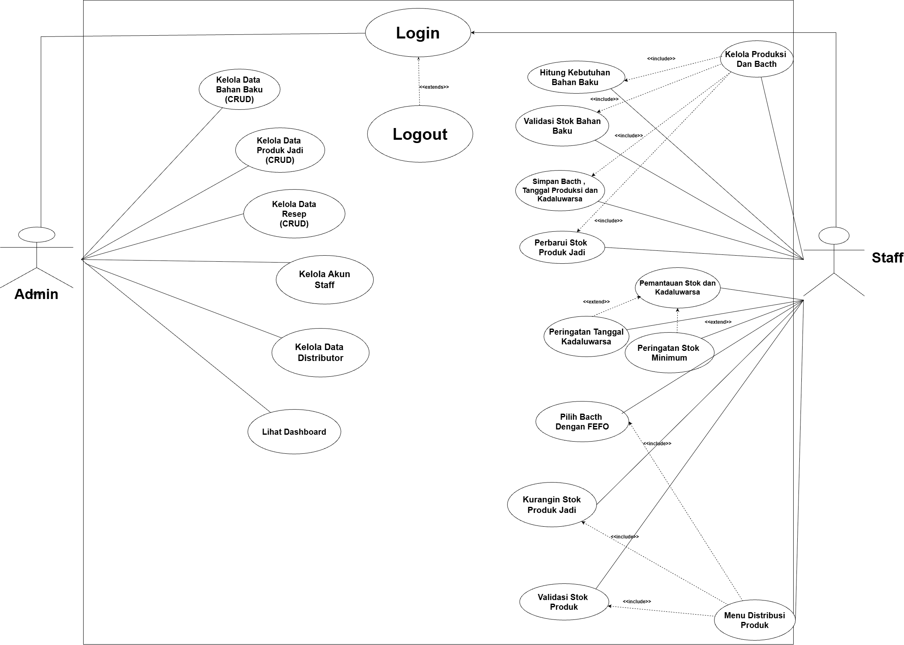   

📎 [Klik di sini untuk melihat Use Case Diagram Lengkap](https://drive.google.com/file/d/1IFRrMQOYuadCL68XmWCmXrVNMFcLsWnm/view?usp=sharing)
 
<details>
<summary><b>📋 Daftar Use Case</b></summary>
 
| No | Use Case | Aktor | Keterangan |
|---|---|---|---|
| 1 | Login | Admin, Staff | Validasi akun dan penentuan peran |
| 2 | Kelola Data Bahan Baku (CRUD) | Admin | Tambah, lihat, ubah, hapus bahan baku |
| 3 | Kelola Data Produk Jadi (CRUD) | Admin | Tambah, lihat, ubah, hapus produk |
| 4 | Kelola Data Resep (CRUD) | Admin | Kelola resep produk |
| 5 | Kelola Data Distributor | Admin | Kelola distributor tujuan |
| 6 | Kelola Akun Staff | Admin | Daftarkan dan kelola akun staf + shift |
| 7 | Lihat Dashboard | Admin | Ringkasan stok, peringatan, riwayat |
| 8 | Kelola Produksi dan Batch | Staff | Hitung Kebutuhan Bahan, Validasi Stok Bahan, Simpan Batch, Perbarui Stok Produk Jadi |
| 9 | Pemantauan Stok dan Kedaluwarsa | Staff | Peringatan Kedaluwarsa, Peringatan Stok Minimum |
| 10 | Menu Distribusi Produk | Staff | Validasi Stok Produk, Pilih Batch FEFO, Kurangi Stok Produk Jadi |
| 11 | Logout | Admin, Staff | Keluar dari sistem |
 
</details>     

### 4.2 Flowchart
**Alur umum sistem:** Login → Pilih menu sesuai hak akses → Input data → Validasi (termasuk cek stok) → Simpan & perbarui stok *(atau tampilkan pesan agar diperbaiki)* → Tampilkan informasi.   

📎 [Klik di sini untuk melihat Flowchart Lengkap](https://drive.google.com/file/d/1GwlGTXFSb7WqmNVU47pCVNrcJJwaFY_7/view?usp=sharing)  

#### 🔐 Tampilan Utama (Login)
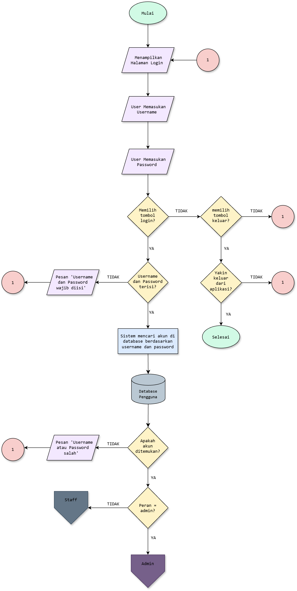
 
#### 👷 Staff
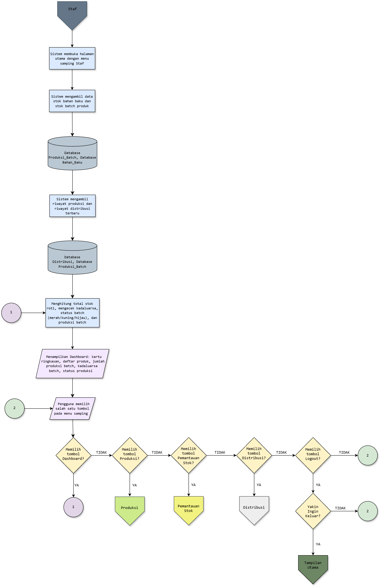
 
#### 🧑‍💼 Admin
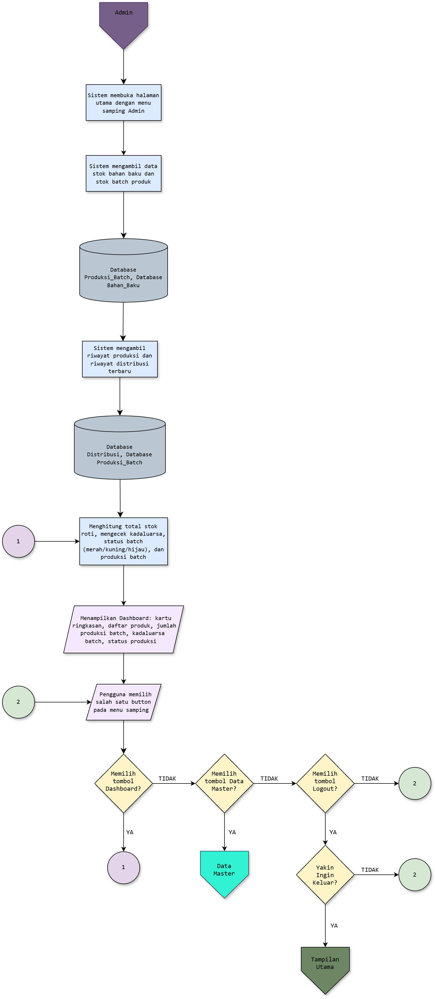
 
#### 🏭 Produksi
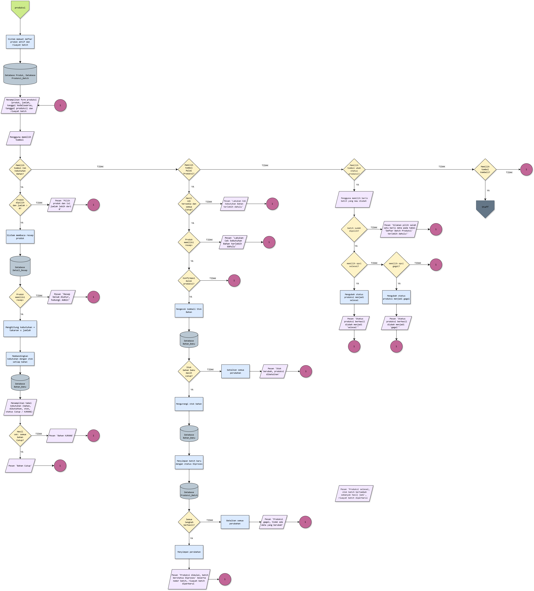
 
#### 🚚 Distribusi
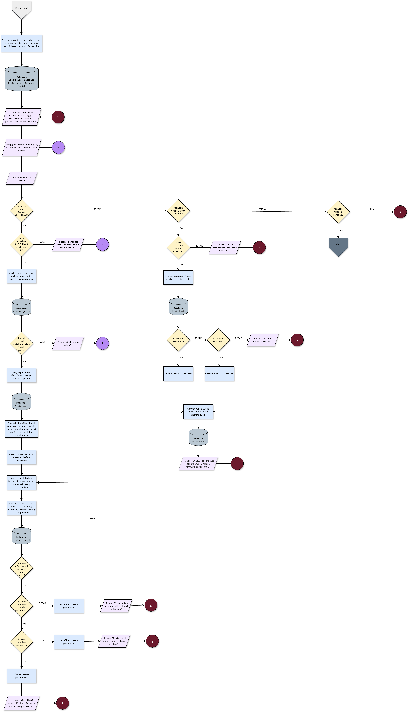
 
#### 📊 Pemantauan Stok
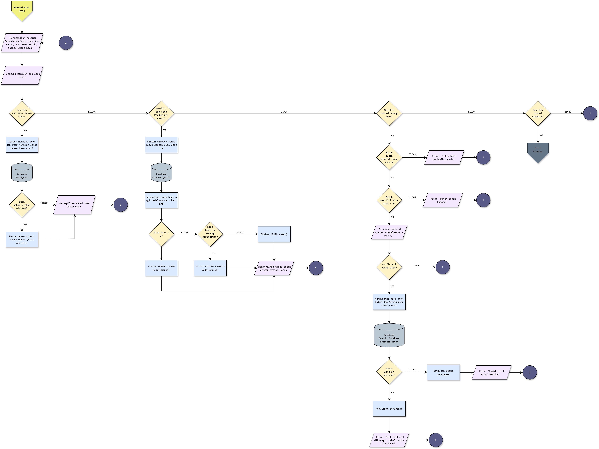
 
#### 🗂️ Data Master
    
 
### 4.3 ERD (Entity Relationship Diagram)    
Rancangan basis data terdiri dari **10 entitas**: `Pengguna`, `Admin`, `Staff`, `Bahan_Baku`, `Produk`, `Detail_Resep`, `Produksi_Batch`, `Distributor`, `Distribusi`, dan `Detail_Distribusi_Batch`.
 
#### 📌 ERD Logical
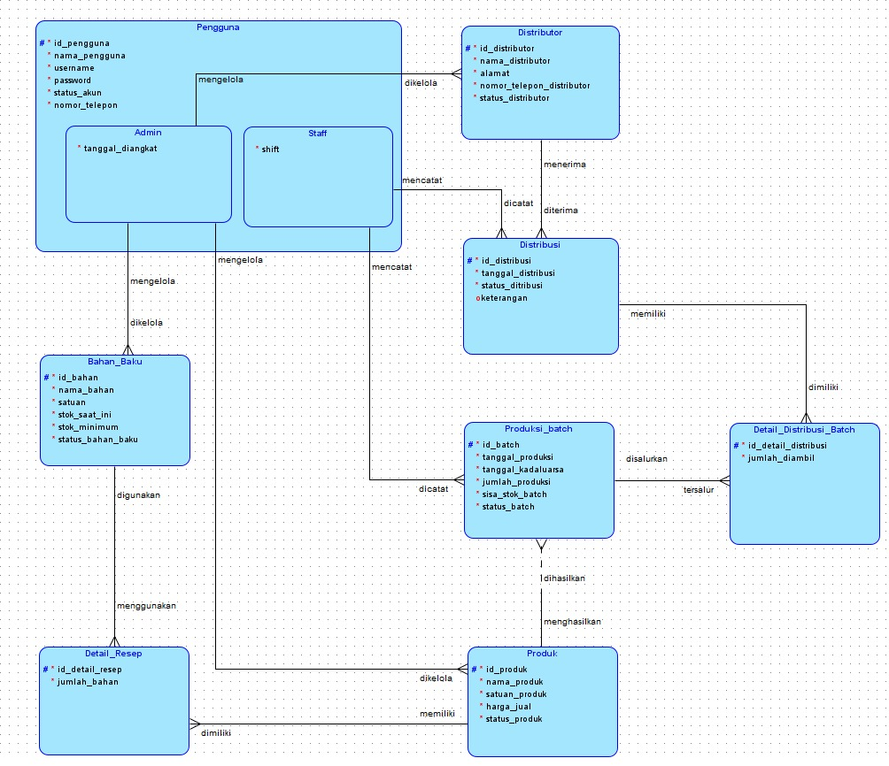
 
#### 📌 ERD Relational
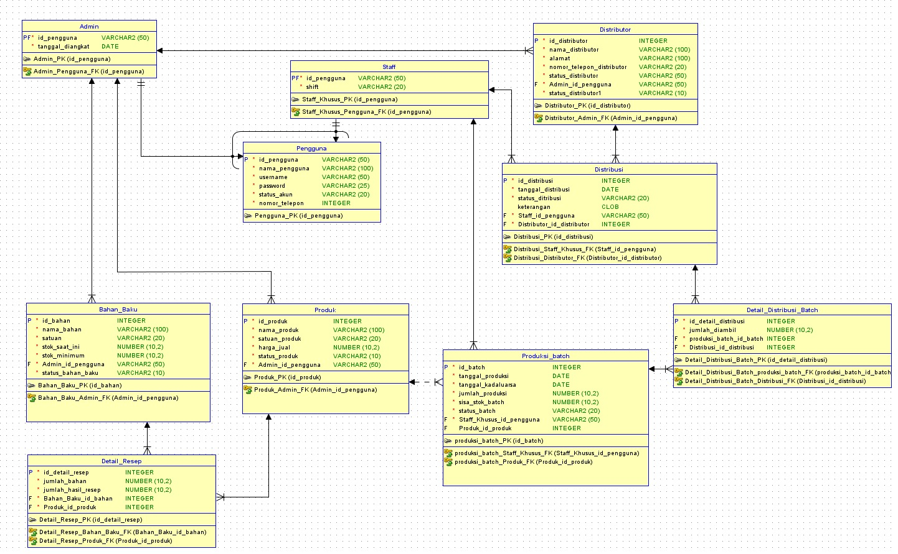
 
📎 [Klik di sini untuk melihat ERD Lengkap](https://drive.google.com/drive/folders/1mCzmc85rA1FsEleD3EEAYkn8AMJl5ZtO?usp=sharing)
 
<details>
<summary><b>📋 Relasi dan Kardinalitas</b></summary>
 
| No | Relasi | Kardinalitas | Foreign Key |
|---|---|---|---|
| 1 | Distributor → Distribusi | 1:M | `Distributor_id_distributor` pada Distribusi |
| 2 | Admin → Distributor | 1:M | `Admin_id_pengguna` pada Distributor |
| 3 | Admin → Bahan_Baku | 1:M | `Admin_id_pengguna` pada Bahan_Baku |
| 4 | Admin → Produk | 1:M | `Admin_id_pengguna` pada Produk |
| 5 | Bahan_Baku → Detail_Resep | 1:M | `Bahan_Baku_id_bahan` pada Detail_Resep |
| 6 | Produk → Detail_Resep | 1:M | `Produk_id_produk` pada Detail_Resep |
| 7 | Produk → Produksi_Batch | 1:M | `Produk_id_produk` pada Produksi_Batch |
| 8 | Staff → Produksi_Batch | 1:M | `Staff_Khusus_id_pengguna` pada Produksi_Batch |
| 9 | Staff → Distribusi | 1:M | `Staff_id_pengguna` pada Distribusi |
| 10 | Distribusi → Detail_Distribusi_Batch | 1:M | `Distribusi_id_distribusi` pada Detail_Distribusi_Batch |
| 11 | Produksi_Batch → Detail_Distribusi_Batch | 1:M | `produksi_batch_id_batch` pada Detail_Distribusi_Batch |
| 12 | Pengguna → Admin / Staff | Generalisasi (supertype–subtype) | `id_pengguna` (PK sekaligus FK) |
 
</details>

---

## 5. 📁 Struktur Folder/Package
 
Project dibangun dengan **Maven** di NetBeans dan menerapkan pola **MVC + DAO**: `view` untuk tampilan, `controller` untuk alur logika, `dao` untuk akses database, dan `model` untuk representasi data.
 
```
capstone_feast_final/
├── src/main/java/capstone_feast/
│   ├── Capstone_feast.java        # Main class (entry point aplikasi)
│   │
│   ├── config/  # Konfigurasi & sesi
│   │   ├── DatabaseConnection.java
│   │   ├── TesKoneksi.java
│   │   └── UserSession.java
│   │
│   ├── model/  # Class entitas / data
│   │   ├── Pengguna.java
│   │   ├── Admin.java
│   │   ├── Staff.java
│   │   ├── BahanBaku.java
│   │   ├── Produk.java
│   │   ├── DetailResep.java
│   │   ├── ProduksiModel.java
│   │   ├── PemantauanModel.java
│   │   ├── Distributor.java
│   │   ├── DistribusiModel.java
│   │   ├── DetailDistribusiBatch.java
│   │   └── ComboItem.java
│   │
│   ├── dao/  # Akses database (query SQL)
│   │   ├── AdminDaoInterface.java
│   │   ├── DaoLoginInterface.java
│   │   ├── LoginDao.java
│   │   ├── AdminDao.java
│   │   ├── StaffDao.java
│   │   ├── BahanBakuDao.java
│   │   ├── ProdukDao.java
│   │   ├── ResepDao.java
│   │   ├── DistributorDao.java
│   │   ├── ProduksiDao.java
│   │   ├── DistribusiDao.java
│   │   ├── PemantauanDao.java
│   │   ├── DashboardAdminDao.java
│   │   └── DashboardStaffDao.java
│   │
│   ├── controller/  # Penghubung view dan dao
│   │   ├── LoginController.java
│   │   ├── RegisterController.java
│   │   ├── AdminController.java
│   │   ├── StaffController.java
│   │   ├── BahanBakuController.java
│   │   ├── ProdukController.java
│   │   ├── ResepController.java
│   │   ├── DistributorController.java
│   │   ├── ProduksiController.java
│   │   ├── DistribusiController.java
│   │   ├── PemantauanController.java
│   │   ├── DashboardAdminController.java
│   │   └── DashboardStaffController.java
│   │
│   └── view/  # Tampilan GUI (Java Swing)
│       ├── Login.java
│       ├── Register.java
│       ├── DashboardAdmin.java
│       ├── DashboardStaff.java
│       ├── BahanBaku.java
│       ├── Produk.java
│       ├── Resep.java
│       ├── Distributor.java
│       ├── KelolaAkunStaff.java
│       ├── Produksi.java
│       ├── Distribusi.java
│       └── PemantauanStok.java
│
├── pom.xml                            # Konfigurasi Maven & dependensi

```
 
---

## 6. 🧱 Penerapan 4 Pilar OOP
Program ini menerapkan empat pilar OOP, terutama pada hierarki class pengguna (`Pengguna` → `Admin` dan `Staff`) dan alur login.
 
### 1️⃣ Encapsulation (Enkapsulasi)   
Seluruh atribut pada class `Pengguna` dideklarasikan **`private`**, sehingga tidak dapat diakses langsung dari luar class. Data hanya bisa dibaca dan diubah melalui **getter dan setter** yang bersifat `public`. Prinsip yang sama dipakai pada class `Admin` (`tanggalDiangkat`) dan `Staff` (`shift`, `password`).
 
📄 `model/Pengguna.java`    
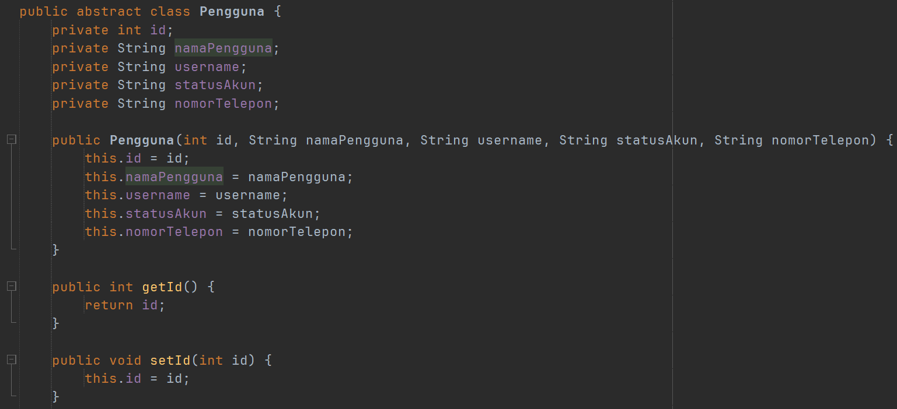   
 
### 2️⃣ Inheritance (Pewarisan)
`Admin` dan `Staff` adalah *subclass* yang mewarisi class induk `Pengguna` melalui kata kunci **`extends`**. Atribut umum (`id`, `namaPengguna`, `username`, `statusAkun`, `nomorTelepon`) cukup ditulis sekali di `Pengguna` dan dipakai bersama, sedangkan atribut khusus ditambahkan di tiap subclass, `Admin` memiliki `tanggalDiangkat`, `Staff` memiliki `shift`, `role`  dan `password`. Constructor subclass memanggil constructor induk dengan **`super`**.
 
📄 `model/Admin.java`    
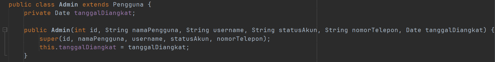     
 
📄 `model/Staff.java`    
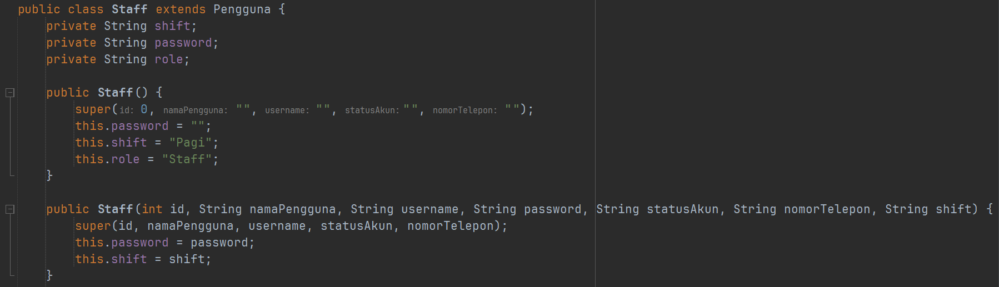     
 
### 3️⃣ Polymorphism (Polimorfisme)
Polimorfisme diterapkan melalui **method overriding**. Method `getRole()` dideklarasikan di class induk `Pengguna`, lalu di-*override* oleh `Admin` dan `Staff` dengan isi yang berbeda sesuai perannya. Dengan begitu, pemanggilan method yang sama (`getRole()`) menghasilkan perilaku yang berbeda tergantung objeknya, objek `Admin` mengembalikan `"Admin"`, sedangkan objek `Staff` mengembalikan `"Staff"`.
 
📄 `model/Admin.java`   
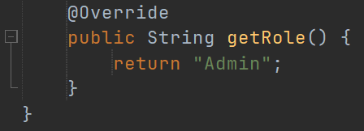       
 
📄 `model/Staff.java`      
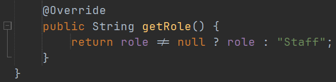       
 
### 4️⃣ Abstraction (Abstraksi)
`Pengguna` dideklarasikan sebagai **`abstract class`**, sehingga tidak dapat dibuat objeknya langsung dan hanya berfungsi sebagai kerangka bagi `Admin` dan `Staff`. Di dalamnya terdapat **abstract method** `getRole()` yang hanya berisi method. Cara kerjanya diserahkan ke masing-masing subclass, sehingga setiap jenis pengguna wajib mendefinisikan perannya sendiri.
 
📄 `model/Pengguna.java`   
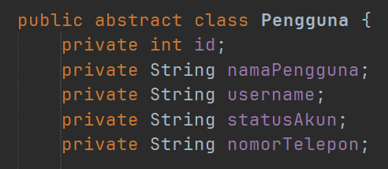       
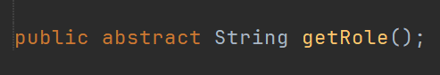       
 
---
 
## 7. 💻 Cara Penggunaan Program
 
### 🛠️ Prasyarat
 
Pastikan perangkat sudah memiliki:
 
| Kebutuhan | Keterangan |
|---|---|
| **JDK (Java Development Kit)** | Project dikembangkan dengan JDK 26 |
| **NetBeans IDE** | Sudah menyertakan Maven, jadi tidak perlu instal Maven terpisah |
| **Laragon** | Menyediakan server MySQL untuk terhubung dan mengelola database |      

         
### 🖼️ Panduan Penggunaan     
#### Tampilan Utama Login


Ini adalah Tampilan Utama yaitu Login yang dimana disini pengguna bisa memasukkan Usernam dan Passwwordnya sesuai dengan Data akun mereka yang sudah terdaftar pada program dan database. Saat Login Pengguna tinggal input data diri nya sebagai apa jika Admin akan lansung masuk ke menu Admin dan jika Staff akan masuk ke menu Staff.


Jika Pengguna salah memasukkan username ataupun password akan muncul peringatan salah saat input passwordnya.

#### Tampilan Dashboard Admin


Ini adalah tampilan dashboard menu admin yang dimana disini dapat di lihat ada card untuk melihat jumlah bahan baku, produk, produksi batch dan transaksi distribusi nya secara real time serta tabel produksi batch terbaru yang sudah di filter dengan warna dan pilihan combo box berdasarkan masing - masing status nya apa.

#### Menu Bahan Baku Admin


Pada Menu Bahan Baku admin ini dapat di lihat admin bisa melakukan untuk menambah bahan baku baru beserta stok nya , lalu admin juga bisa mengubah bahan baku beserta stok nya untuk restok apabila dari staff request untu kebutuhan bahan baku yang kurang buat produksi produk dan terakhir admin bisa melakukan hapus bahan yaitu untuk menonaktifkan bahan baku. Dan ada tabel bahan baku juga untuk melihat daftar bahan baku yang sudah ada beserta jumlah masing masing stoknya yang ada saat ini dan stok minimumnya serta jika stok nya sudah minimum akan di beri tanda warna merah agar admin dapat memudahkan juga untuk mengetahui bahan baku yang perlu segera di restock.


Ini adalah tampilan apabila bahan baku yang ingin di tambahkan itu data nya sudah ada , maka program akan menampilkan bahwa bahan baku tersebut sudah ada jika tetap ingin menambahkan maka data bahan baku yang duplikat tersebut yang tertambah hanya stok nya bukan data bahan baku nya. Ini juga demi menghindari duplikasi pada data agar tidak berantakan.

#### Menu Produk Admin


Selanjutnya ke menu tampilan Produk yang dimana disini admin bisa melakukan tambah produk apabila ada produk baru lalu bisa juga mengubah data produk nya dan terakhir admin bisa melakukan hapus produk untuk menonaktifkan data produk nya, jika status produknya nonaktif maka pada tab produksi batch pun data produk tersebut tidak akan muncul.


Jika data produk yang ingin di tambahkan itu sudah ada di database maka proses penambahan produk tersebut pun tidak akan berhasil dan akan di arah kan untuk melakukan update untuk memperbarui data nya, ini juga demi mencegah duplikasi data agar data pada program tidak berantakan.

#### Menu Resep Admin


Pada Menu Resep admin akan mengelola resep dari setiap produk itu bahan dan takaran yang di butuhkan apa saja , mulai dari admin bisa melakukan penambahan resep dari setiap produk yang ada , lalu mengubah takaran dari bahan resep yang ada dan menghapus resep atau menghapus kebutuhan bahan pada daftar resep yang ada pada masing-masing produk. Jika admin sebelumnya menambahkan produk baru maka di tab resep nanti produk tersebut belum memiliki resep , maka admin akan bisa melakukan penambahan resep dan kebutuhan bahan nya serta jumlah takarannya apa saja.

#### Menu Distributor Admin


Pada Menu Distributor admin akan melakukan pengelolaan terkait data distributornya apa saja untuk menjadi tujuan dari distribusi yang telah di lakukan oleh staff saat kegiatan operasionalnya. Disini admin bisa melakukan penambahan data distributor baru , lalu mengubah data distributornya dan menghapus data distributor untuk menonaktifkan data distributornya.


Jika admin ingin melakukan penambahan data distributor baru lalu data tersebut sudah ada pada program atau database program akan muncul notifikasi data tersebut sudah dan akan di arah kan untuk melakukan ubah data untuk memperbarui nya , guna nya adalah untuk mencegah duplikasi data pada program dan database agar data tidak berantakan juga.

#### Menu Kelola Akun Staff


Selanjutnya ke menu tampilan kelola akun staff yang dimana admin akan mengelola akun staff yang ada dan dapat di lihat pada tampilan admin bisa melakukan penambahan akun staff jika admin ingin melakukan tambah akun staff maka nanti akan berpindah ke tab register akun staff, lalu admin bisa melakukan update data akun staff dan terakhir hapus akun staff untuk menonaktifkan data akun staff tersebut apabila staff tersebut misalnya sudah tidak bekerja di perusahaan tersebut.

#### Register Akun Staff


Ini adalah tampilan jika admin ingin menambahkan data akun staff yang baru mulai dari menambahkan nama Lengkap staff , username no telepon dan password baru untuk staff.


Jika passwordnya tida mencapai 6 karakter akan muncul validasi notifikasi password akun harus mencapai 6 karakter.


---
 
## 8. 👥 Kontributor

| No | Nama | NIM |
|---|---|---|
| 1 | Ahmad Ahdasuki | 2509116021 |
| 2 | Rivalio Chendra | 2509116039 |
| 3 | Muhammad Aqia Yudha Yulian Putra | 2509116105 |
| 4 | Meilanie | 2509116109 |
 
---         

[⬆️ Kembali ke Atas](#-sistem-informasi-pengelolaan-stok-bahan-baku-produksi-dan-distribusi-produk-jadi-berbasis-java)
